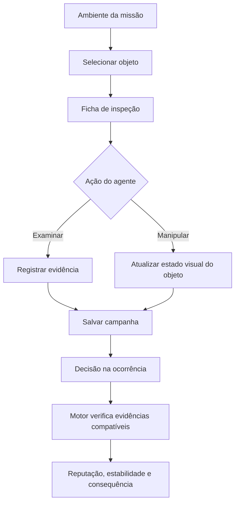

# Plano técnico — Turnos Zero

## 1. Visão do produto

Turnos Zero é um jogo 2D de horror sobrenatural e sobrevivência burocrática. O jogador é um funcionário de uma agência de serviços extraordinários, recebe contratos perigosos, lê protocolos, investiga locais anômalos e tenta quitar uma dívida de R$ 1.000.000.

A direção visual combina quatro princípios: documentos manipuláveis e decisões de inspeção (*Papers, Please*), ferramentas analógicas e terminais de sobrevivência (*Alien: Isolation*), equipamento diegético (*Dead Space*) e arquitetura institucional opressiva (*Control*). Essas obras são referências de linguagem e interação; os cenários, personagens, textos, objetos e acontecimentos de Turnos Zero são originais.

## 2. Loop principal

1. **Admissão:** informar o nome do crachá e escolher o vínculo.
2. **Dossiê:** consultar dívida, remuneração, risco, local e protocolos.
3. **Preparação:** conferir o cinto de equipamentos.
4. **Investigação:** explorar o cenário, selecionar objetos e examinar anomalias.
5. **Manipulação:** abrir, acionar, tocar ou desligar objetos; o estado permanece salvo no contrato.
6. **Ocorrências:** resolver três situações e tomar decisões apoiadas pelas evidências.
7. **Sobrevivência:** erros reduzem estabilidade conforme o multiplicador de risco do contrato.
8. **Pagamento:** concluir o trabalho reduz a dívida e libera o próximo contrato.

## 3. Economia e dificuldade

- Dívida inicial: **R$ 1.000.000**.
- Pagamento do primeiro contrato: **R$ 50**.
- Pagamento dobra a cada contrato: **R$ 50, R$ 100, R$ 200, R$ 400, R$ 800...**.
- Multiplicador de risco também dobra: **x1, x2, x4, x8, x16...**.
- A estabilidade inicial depende do vínculo. O dano de uma falha é multiplicado pelo risco atual; contratos posteriores ficam progressivamente mais difíceis de sobreviver.
- O progresso continua em ciclos de quatro ambientes, com os contratos e riscos escalando até o limite técnico da campanha.

## 4. Arquitetura atual

- `main.py`: interface Tkinter Canvas, modo terminal, telas de investigação, inspeção e ocorrência.
- `turnos_zero.py`: motor de missão, economia, dificuldade, equipamentos, evidências, estados de objetos e salvamento.
- `scene_manager.py`: carregamento e validação de cenas, coordenadas e hotspots.
- `dados/cenas.json`: catálogo de fundos e hotspots de fallback.
- `dados/objetos_cenas.json`: posição, dimensão, camada, visibilidade, hotspot e sprite alternativo de cada objeto.
- `assets/ambientes/`: fundos das missões e fontes SVG editáveis.
- `assets/objetos/`: 16 objetos PNG independentes e fontes SVG; cinco objetos possuem variações visuais quando manipulados.
- `tools/editor_cenas.py`: editor visual de objetos, com arrastar, redimensionar, ordenar, ocultar e substituir PNG.
- `tools/export_assets.py`: exporta fundos em 834×315 e objetos em 512×512.
- `dados/turnos_zero_progresso.json`: campanha e estados persistidos.
- `dados/turnos_zero_historico.json`: histórico de contratos.
- `tests/`: testes de motor, cenas, objetos, economia e persistência.
- GitHub Actions: exportação e testes em Python 3.10, 3.11 e 3.12.

## 5. Sistemas implementados

### Ambientes e objetos
- Fundos de missão carregados em viewport proporcional 834×315.
- 16 sprites independentes para loja, edifício, cinema e laboratório.
- Cada objeto usa `x/y/w/h/z/visible`; o renderizador respeita a escala configurada e preserva a proporção do sprite.
- Hotspots acompanham os limites configurados do objeto.
- Editor usa o mesmo viewport que o jogo.
- Variações de sprite existem para geladeira, elevador, projetor, terminal e luz de emergência.

### Investigação e manipulação
- Selecionar um hotspot abre ficha própria de inspeção.
- Exame registra evidência explicitamente; a seleção do objeto não coleta pista automaticamente.
- Interagir altera o estado do objeto e salva a mudança no contrato.
- Evidências e estados não vazam para o próximo contrato.

### Equipamentos
- **Lanterna:** ativa um cone de iluminação; começa com 100% e consome 35 pontos por decisão enquanto ligada.
- **Rádio:** exibe orientação contextual da central; possui três transmissões por contrato.
- **Câmera:** ativa visual de gravação/scanlines e permite fotografar evidências; possui três fotos por contrato.
- Os recursos são repostos quando um novo contrato é iniciado; decisões e evidências não são apagadas.
- Inventário e estados de equipamentos são persistidos; saves antigos recebem os padrões sem perder progresso.

### Interface e áudio
- Menu e documentos institucionais preservam a linguagem burocrática da agência.
- Terminal do laboratório tem painel CRT com logs verdes e scanlines.
- Sons de acerto e violação são executados de forma assíncrona no Windows, com fallback para beep do Tk em plataformas sem `winsound`.
- Interface mantém proporção ao redimensionar a janela e converte cliques para o mesmo espaço lógico.

## 6. Missões atuais

1. **Loja 24 horas:** balcão, prateleiras, geladeira, porta de vidro e anomalia ligada ao telefone e ao corredor.
2. **Edifício Residencial 9:** porta, elevador, presença e painel de andar 0.
3. **Última Sessão:** projetor, tela com marcas, poltrona e espectador.
4. **Protocolo de Contenção:** câmaras de contenção, terminal persistente e luz de emergência.

Cada ambiente possui pontos de investigação, evidências, objetos manipuláveis e três ocorrências narrativas.

## 7. Próximas etapas

### Etapa 1 — Renderização e interação (base implementada)
- [x] Corrigir proporção do viewport e dos sprites.
- [x] Publicar os objetos independentes e o pipeline de exportação.
- [x] Alinhar editor e jogo ao viewport 834×315.
- [x] Inspeção e estados persistentes de objetos.
- [x] Variantes visuais de objetos manipulados.
- [ ] Melhorar qualidade e variedade dos fundos e das animações de ambiente.
- [ ] Teste manual de escala, cliques e estados no Windows.

### Etapa 2 — Interface diegética e equipamentos (base implementada)
- [x] Cinto com lanterna, rádio e câmera.
- [x] Terminal CRT específico do laboratório.
- [x] Feedback sonoro de decisão.
- [ ] Dossiê da agência com documentos e carimbos realmente manipuláveis.
- [ ] Relatório fotográfico de evidências e arquivo de gravações.

### Etapa 3 — Terror e sobrevivência (em desenvolvimento)
- [ ] Áudio ambiente por missão, ruídos posicionais e eventos de rádio.
- [ ] Eventos dinâmicos que mudam o ambiente durante o turno.
- [ ] Ameaças com padrões de aproximação, perseguição e esconderijos.
- [ ] Recursos limitados de lanterna, câmera e rádio.
- [ ] Consequências visuais e sonoras mais fortes para violações.

### Etapa 4 — Campanha e progressão
- [x] Dívida de R$ 1.000.000, pagamento e risco dobrando por contrato.
- [ ] Mais contratos originais e variações de cada local.
- [ ] Funcionários recorrentes, arquivos secretos e consequências entre contratos.
- [ ] Finais alternativos e formas diferentes de quitar ou renegociar a dívida.

### Etapa 5 — Qualidade e entrega
- [x] Testes automatizados em três versões do Python.
- [x] Validação de PNGs, JSON, hotspots e sprites alternativos.
- [ ] Teste visual de todas as telas no Windows.
- [ ] Teste de campanha longa, falhas, retomada e migração com saves reais.
- [ ] Empacotamento executável e roteiro final de apresentação.

## 8. Fluxo de uma pista

## 9. Estados persistidos e qualidade

- `between_shifts`: contrato aguardando início ou próximo contrato disponível.
- `on_shift`: expediente em andamento; investigação, inspeção e equipamento permitidos.
- `ended`: contrato encerrado por falha.
- `campaign_completed`: limite técnico da campanha atingido.

O motor valida posição da campanha, economia, evidências, estados de objetos e equipamentos. Saves antigos sem inventário recebem os equipamentos padrão. A gravação usa arquivo temporário e substituição.

GitHub Actions compila os módulos, exporta fundos e sprites, executa os testes e valida os JSONs em Python 3.10, 3.11 e 3.12. **O CI não substitui a validação manual da interface no Windows**, ainda pendente.
